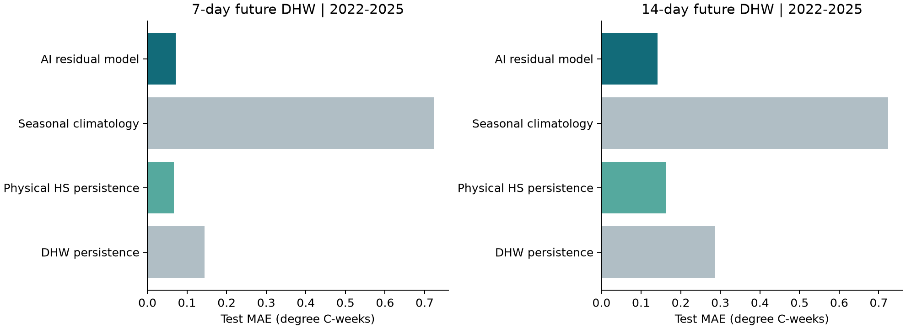
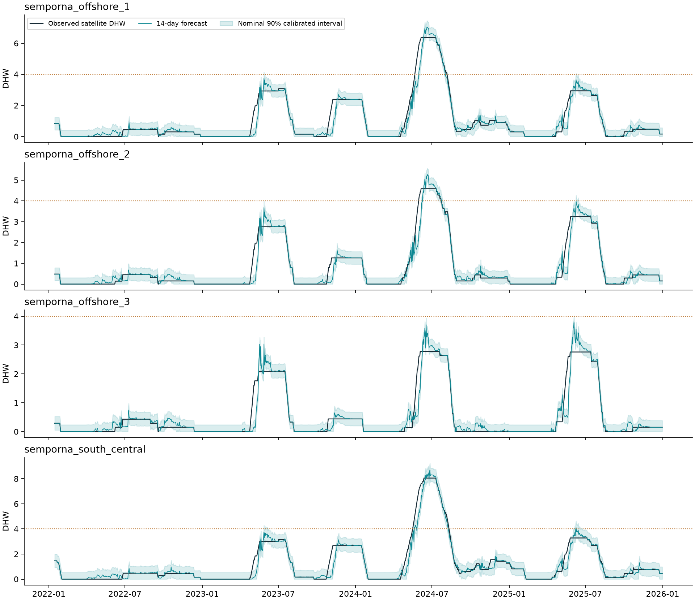

# Evaluation report

Frozen temporal evaluation. All daily predictions are preserved in `artifacts/test_predictions.csv`; site/year metrics in `artifacts/year_metrics.csv`. No field bleaching ground truth is available.

| Horizon | Selected model | Test MAE | Physical MAE | DHW persistence MAE | 90% interval coverage | DHW>=4 recall |
|---|---|---:|---:|---:|---:|---:|
| 7 days | physical_persistence | 0.0666 | 0.0666 | 0.1439 | 0.889 | 0.972 |
| 14 days | random_forest_residual | 0.1422 | 0.1620 | 0.2866 | 0.890 | 0.866 |

7-day paired block-bootstrap MAE gain versus physical persistence: 0.0000; descriptive 95% interval [0.0000, 0.0000]. Positive favors the selected model. If the interval crosses zero, superiority is not established.

14-day paired block-bootstrap MAE gain versus physical persistence: 0.0198; descriptive 95% interval [-0.0031, 0.0428]. Positive favors the selected model. If the interval crosses zero, superiority is not established.

## Interpretation

MAE includes all eligible site-days and may be dominated by zero-stress days. Heat-stress MAE, event precision/recall, crossing counts, site/year metrics and interval coverage must accompany it. Nearby pixels are correlated; daily row count is not an independent evidence count. Coverage below 0.90 is a demonstrated limitation and is not repaired on the test set.

## Reproduction

From `.`: `OMP_NUM_THREADS=4 .venv/bin/python -m src.train`; then `.venv/bin/python -m pytest tests -q`.

## Post-evaluation interpretation

The 7-day validation winner is physical persistence; its reported selected-model performance is not an AI gain. The 14-day winner is the random-forest residual model.

On the 2022–2025 test set, exact-lead first crossings of satellite DHW=4 were detected in 2/3 cases at 7 days and 0/3 at 14 days. These are three correlated pixel-level upcrossings, all in 2024-05, not three independent ecological events. Event-day recall includes already-ongoing stress and must not be presented as evidence of new-event early-warning skill.

For the 14-day forecast, MAE is 0.142168 versus 0.161956 for physical persistence (12.22% lower), but its descriptive block-bootstrap improvement interval [-0.003064, 0.042833] includes zero. False-positive pixel-days fall from 94 to 3, while false negatives rise from 10 to 29; heat-stress-day MAE increases from 0.440913 to 0.487346. There is no established universal superiority.

Nominal 90% intervals cover 88.89% and 89.03% of 7-/14-day test labels; 14-day coverage is 86.35% in the 2026 retrospective replay. These are empirical findings, not coverage guarantees.

In the 2026 replay, 14-day selected-model MAE is 0.183706, worse than the physical baseline (0.167264); the 2022–2025 average improvement does not establish future superiority.

See [complete interpretation, onset cases and annual results](evaluation_analysis.md). Rebuild this section after training with `.venv/bin/python scripts/write_evaluation_analysis.py`; this postprocessor leaves the frozen training source and model artifacts unchanged.
